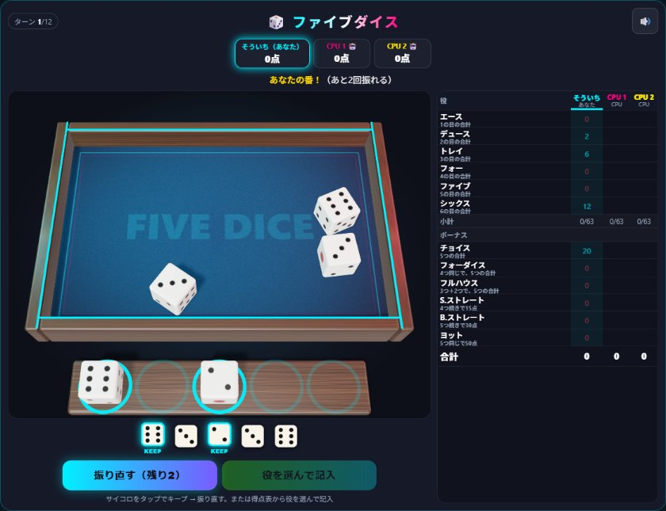
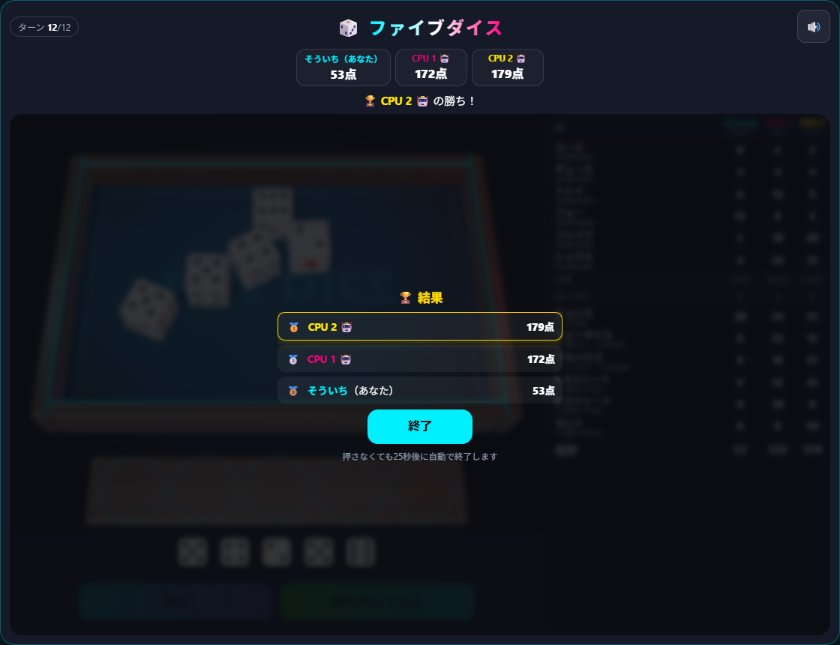

# 【遊び方】ファイブダイス：サイコロ5つで12の役を埋める

「**ファイブダイス**」は、サイコロ5つを振って役を作り、得点表の12のマスを1つずつ埋めていく2〜4人用のゲームです。サイコロは3Dの物理演算で、フェルト張りのトレイの中を本当に転がります。木の枠に当たって跳ね、ぶつかり合いながら止まるまで、全員の画面に同じ出目が出ます。人数が足りないときはCPUが入ります。

## 1. ゲームの流れ

1. 参加者が1人ずつ順番に番を行います。全員が12回ずつ番を終えたら、ゲーム終了です。
2. 自分の番では、まず「振る」でサイコロ5つを振ります。
3. 残したいサイコロをタップすると「キープ」され、手前の台に移ります。もう一度タップするとトレイに戻ります。
4. 「振り直す」で、キープしていないサイコロだけを振り直せます。1回の番で振れるのは、最初の1回を含めて**3回まで**です。
5. 得点表の空いているマスを1つ選んで記入すると、自分の番は終わりです。3回振る前でも記入できます。

## 2. 役と得点

| 役 | 条件 | 得点 |
|---|---|---|
| エース | なし | 1の目の合計 |
| デュース | なし | 2の目の合計 |
| トレイ | なし | 3の目の合計 |
| フォー | なし | 4の目の合計 |
| ファイブ | なし | 5の目の合計 |
| シックス | なし | 6の目の合計 |
| チョイス | なし | 5つの目の合計 |
| フォーダイス | 同じ目が4つ以上 | 5つの目の合計 |
| フルハウス | 同じ目3つ＋同じ目2つ（5つ同じでもよい） | 5つの目の合計 |
| S.ストレート | 4つ続きの目（1-2-3-4・2-3-4-5・3-4-5-6） | 15点 |
| B.ストレート | 5つ続きの目（1-2-3-4-5・2-3-4-5-6） | 30点 |
| ヨット | 5つとも同じ目 | 50点 |

- 条件を満たしていない役にも記入できますが、そのマスは**0点**になります。いらない役を「捨てる」ために使います。
- 一度記入したマスは書き直せません。
- **ボーナス**：エース〜シックスの6つの合計が**63点以上**になると、35点が加わります。63点は、どの目も3つずつそろえたときの合計です。

例：出目が 3・3・3・5・5 のとき、フルハウスなら19点、トレイなら9点、ファイブなら10点、チョイスなら19点です。

## 3. 勝敗

12ターンが終わったとき、合計点（ボーナスを含む）が一番高い人の勝ちです。合計点が一番高い人が2人以上いるときは引き分けです。

## 4. 操作と演出

- サイコロのキープは、トレイの中のサイコロをタップするか、ボタンの上に並んだ出目をタップします。
- 得点表で、自分の列の空いているマスには、いまの出目で記入したときの点が薄く表示されます。マスを選んで「記入」を押すか、選んだマスをもう一度タップすると記入します。
- 30秒操作がないと、自動で振るか、一番よさそうな役に記入します。
- サイコロが転がっている間にトレイをタップすると、転がる様子をスキップして結果を出します（自分の画面だけで、出目は変わりません）。
- ヨットやB.ストレートが出たときは、大きな演出が出ます。右上のスピーカーのボタンで、音をオン・オフできます。

## 5. 楽しみ方のコツ

- **ボーナスをねらう**：上の6つで各目を3つずつそろえれば63点。4つそろえた目があれば、ほかで少し足りなくても届きます。
- **捨てる役を決めておく**：うまくいかなかった番のために、0点になってもいい役（エースやヨットなど）を残しておくと、大事な役を守れます。
- **ヨットはねらいすぎない**：1つの番で3回振ってヨットがそろう確率は、うまくキープしても約4.6%です。ほかの役との兼ね合いで考えましょう。
- **配信にもおすすめ**：OBS透過モードに対応しています。背景が透けても、サイコロの影は残ります。
